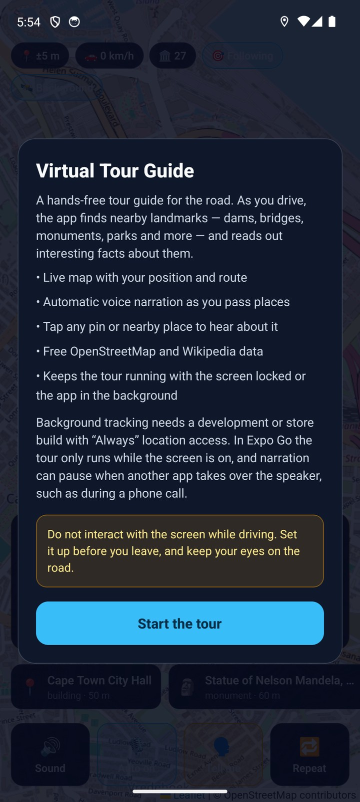
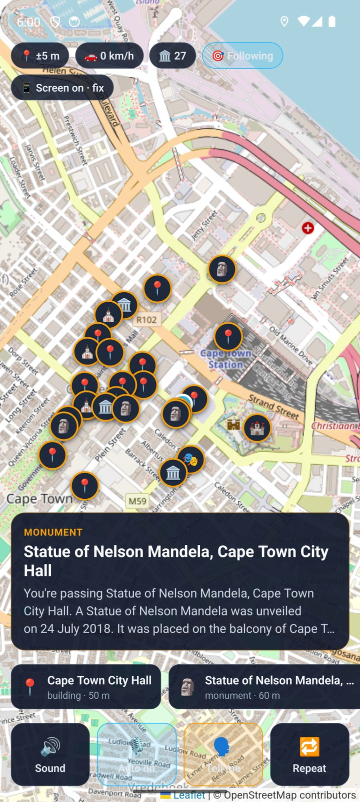
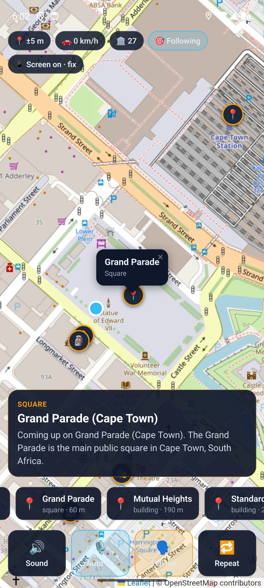

# Virtual Tour Guide

A hands-free Android tour guide for the road. Drive past a dam, a bridge, a monument or a
cathedral and the app tells you what it is, out loud, before you reach it. No account, no API
keys, no paid services — it runs entirely on free OpenStreetMap and Wikipedia data.

[](https://github.com/JacyFleisie/virtual-tour-guide/releases/latest/download/virtual-tour-guide.apk)

**[⬇ Download the latest APK](https://github.com/JacyFleisie/virtual-tour-guide/releases/latest/download/virtual-tour-guide.apk)** ·
[All releases](https://github.com/JacyFleisie/virtual-tour-guide/releases) ·
[Report a bug](https://github.com/JacyFleisie/virtual-tour-guide/issues)


---

## Screenshots

<table>
  <tr>
    <td align="center" width="33%">
      <br />
      <sub><b>First launch</b> — safety note on screen while driving and what the tour will do</sub>
    </td>
    <td align="center" width="33%">
      <br />
      <sub><b>Live tour</b> — position, speed and landmark count up top, pins on the map, the story being read out, nearby places and the four controls</sub>
    </td>
    <td align="center" width="33%">
      <br />
      <sub><b>Tap a landmark</b> — map zooms to the pin, opens its popup and reads the story</sub>
    </td>
  </tr>
</table>

Captured from the release build on Android 14 with a simulated drive through central Cape Town.

---

## Download and install

1. Open the download link above on your Android phone (or transfer the APK to it).
2. Tap the downloaded `virtual-tour-guide.apk`.
3. If Android warns about unknown sources, allow your browser or file manager to install apps.
4. Open **Virtual Tour Guide** and allow location access. Choose **Allow all the time** so the
   tour keeps running with the screen locked.
5. Press **Start the tour**, put the phone down, and drive.

The build is a release build signed with a development key, so it installs cleanly on a normal
phone but is **not** Play-Store ready. Android may show a Play Protect prompt the first time —
choose "install anyway". Tested on Android 14 (API 34). It needs a network connection for map
tiles, landmark data and Wikipedia summaries; everything already heard is cached afterwards.

> **Safety:** set the tour up before you leave and do not touch the screen while driving.

---

## What it does

- **Narrates on approach.** A speed-scaled cue window starts a story roughly 20 seconds before you
  reach a landmark, and places off your nose (already passed) are skipped.
- **Live map.** Leaflet in a WebView over OpenStreetMap tiles, with your pulsing position dot, the
  breadcrumb trail of where you have driven, and tappable pins for every landmark found.
- **Hands-free by default.** Auto narration uses the phone's text-to-speech; nothing needs to be
  read or tapped.
- **Background tracking.** An Expo background-location task plus an Android foreground service
  keeps listening with the screen off or the app closed — narration still plays.
- **Works on tap too.** "Tell me" narrates the nearest landmark, "Repeat" replays the last story,
  and tapping any pin or nearby chip plays that place.
- **Remembers what you have heard.** A story is not repeated for 60 minutes or within 800 m of
  where you heard it, so a round trip does not loop the same facts.
- **Offline-tolerant for text.** Summaries and images already fetched are cached in SQLite and
  spoken again without a network round trip.
- **Filter the noise.** Minimum interest score, sound and auto-narration are all toggleable.

---

## How it works

The whole app is one pipeline. Every piece is in `src/`.

```
GPS fix ──► tour engine ──► POI fetch (Wikipedia + Overpass) ──► filter & rank
                │                                                   │
                └────────── cue window + heading ──► narration ◄─────┘
```

### 1. Location, including with the screen locked

`src/lib/backgroundLocation.ts` prefers OS-driven background updates
(`expo-task-manager` + `expo-location`, 50 m / 10 s, automotive navigation accuracy) and registers
a foreground service with a persistent notification. If the user has not granted "all the time"
access, it falls back to a foreground watcher and says so in the UI. If access is granted later in
system settings, returning to the app upgrades the watcher without a restart.

`src/lib/tourEngine.ts` is a module-scope singleton, deliberately outside React: the background
task and the screen both feed it samples, and both listen to the same state. That is what lets
narration continue while no UI is mounted.

A 50 m interval is deliberate. The cue window opens 300 m or more before a landmark, so 50 m is
plenty precise for timing a story, while waking the GPS five times less often than a 20 m
interval keeps a long drive from draining the battery.

Bad fixes are rejected before they reach the tour: anything with an accuracy worse than 500 m is
dropped, and a jump that implies more than 75 m/s (270 km/h) since the last fix is treated as a
GPS re-acquisition spike. A single such spike would otherwise skip a whole landmark and poison
the trail. Narration additionally ignores fixes coarser than 300 m, since they cannot tell which
side of the road a place is on.

### 2. Finding landmarks

Two free, keyless sources are queried in parallel around your position:

| Source | File | What it contributes |
| --- | --- | --- |
| Wikipedia geosearch | `src/lib/wikipediaGeo.ts` | Articles within radius, classified into a place type from the title + description |
| OpenStreetMap / Overpass | `src/lib/overpass.ts` | Tagged features: `historic`, `man_made`, `waterway`, `tourism`, `natural`, `leisure`, `amenity` |

Wikipedia publishes first (it is fast) and OSM pins merge in when the mirror answers, so the map
fills immediately even when Overpass is slow. Overpass requests race a 12 s deadline and rotate
through three public mirrors; a dead source simply never publishes. Duplicate landmarks that
arrive from both sources are collapsed by normalised name, keeping the higher-interest copy.

Every outbound request sends a descriptive `User-Agent` (`src/lib/userAgent.ts`) — Wikimedia and
Overpass return `403` to React Native's default `okhttp` agent.

### 3. Scoring what is worth narrating

`src/lib/interests.ts` maps OSM tags to a kind and an interest score (0–100); a place tagged with
`wikipedia` or `wikidata` gets a +10 bump because there is a story to tell. The Wikipedia source
uses an equivalent rule table in `wikipediaGeo.ts`, plus a blocklist so articles about events,
battles, shootings or "list of…" pages are not treated as places. Examples: dam 94, castle 92,
lighthouse 91, monument 88, museum 84, bridge 84, cathedral 82, park 62, library 58.

### 4. Narration that leads instead of trails

`narrateBestCandidate()` runs on **every GPS fix**, not only when a fetch returns, and picks the
nearest qualifying landmark inside the cue window:

- **Cue distance** = `300 m + 18 s × speed`, clamped to 300–1600 m. The lead is roughly the length
  of the spoken story, so the facts finish just as you reach the place. At a standstill the cue is
  300 m; at 100 km/h it is 800 m.
- **Along-track test, not a compass cone.** The bearing to each candidate is split against your GPS
  heading into how far *ahead* it is along your line of travel and how far *off* that line it sits.
  A place may be at most `clamp(cue × 0.3, 180, 600) m` off the line (240 m at 100 km/h) and must
  still be ahead, give or take 40 m of GPS lag. This drops places on a parallel street and towns a
  motorway merely passes, and it rejects anything already behind you regardless of compass error.
  The test only applies above 3 m/s, because heading is stale when you are stopped at a light.
- **Soonest reached first**, then interest, because at speed the cue window is wide.
- **One story at a time.** Nothing new starts while the speaker is talking, so a landmark is never
  cut off mid-sentence; the next story begins on the first fix after the previous one finishes
  (2.5 s backstop).
- **Phrasing adapts**: `Dordrecht Museum, 700 metres ahead.` on approach, `You're passing X.`
  within 60 m, and plain `Coming up on X.` for a place you tapped yourself.

`src/lib/narration.ts` picks the clearest installed English voice once per run (enhanced or Google
network voices score highest), speaks at rate 0.92, pitch 1.0 and full volume, strips citations
and bracketed asides from the extract, and trims it to whole sentences (≤300 characters, about
18 s of speech) so the important first lines are never the part that gets lost. The speech queue
holds one utterance: a new story replaces an old one rather than stacking behind it.

| Speed | Cue distance | Lateral limit | Fetch radius |
| --- | --- | --- | --- |
| 0 km/h | 300 m | 180 m | 1000 m |
| 50 km/h | 550 m | 180 m | 1000 m |
| 100 km/h | 800 m | 240 m | 1000 m |
| 130 km/h | 950 m | 285 m | 1140 m |

POIs are re-fetched every 250 m of travel or 30 s, whichever comes first, with a 1 km minimum
radius and a list capped at 120 places.

### 5. Caching and memory

`src/lib/db.ts` (SQLite via `expo-sqlite`, WAL mode) stores two tables: `pois` for fetched
summaries and thumbnails, and `narrated` for what was played and where. Settings and the intro
flag live in AsyncStorage (`src/lib/settings.ts`). Everything is on-device; nothing is uploaded.

---

## Screens and controls

| Element | Behaviour |
| --- | --- |
| Map | Pan and zoom freely; pins open a popup with name and kind |
| Pills (top) | GPS accuracy, speed, landmark count, follow mode, tracking mode |
| Story card | Kind, title and the first lines of the current narration |
| Chips (bottom) | The 12 nearest landmarks with distance; tap to hear one |
| 🔊 Sound | Mute / unmute. Muting also stops current speech |
| 🎙️ Auto | Toggle automatic narration on approach |
| 🗣️ Tell me | Narrate the nearest landmark within 2.5 km |
| 🔁 Repeat | Replay the last story |
| 🎯 Following | Keep the map centred on you, or leave it free |
| 🛰️ Background | Tap when limited to screen-on tracking to open the permission flow |
| Intro | Shown once: what the app does, background access, and the driving warning |

---

## Project structure

```
App.tsx                     single screen: map, pills, story card, chips, controls, intro
src/
  components/TourMap.tsx    Leaflet 1.9.4 map inside a WebView, bridged over postMessage
  hooks/useTourGuide.ts     permission flow, tracking mode, settings, derived nearby list
  lib/
    tourEngine.ts           shared state, cue logic, fetch scheduling, narration decisions
    backgroundLocation.ts   background task + foreground watcher + permission helpers
    wikipediaGeo.ts         Wikipedia geosearch POI source and place classifier
    overpass.ts             OSM POI source with mirror rotation and timeouts
    interests.ts            OSM tag → kind + interest score
    wiki.ts                 article summary lookup (tag first, then search)
    narration.ts            script building and queued text-to-speech
    db.ts                   SQLite cache and "already narrated" memory
    settings.ts             persisted settings and intro flag
    geo.ts                  haversine distance and distance formatting
    icons.ts                emoji per place kind
    userAgent.ts            descriptive User-Agent for free API etiquette
  types.ts                  shared Poi / GeoPosition / NarrationCard types
```

## Tech stack

Expo SDK 58 · React Native 0.88.1 · React 19 · TypeScript · `expo-location` ·
`expo-task-manager` · `expo-speech` · `expo-sqlite` · `react-native-webview` ·
`@react-native-async-storage/async-storage`. No map SDK key: the map is Leaflet + OSM tiles in a
WebView, which avoids Google Maps billing entirely.

---

## Build from source

Requires Node, a JDK 17+, and the Android SDK. A native `android/` folder is generated, so the repo
ships only the Expo config.

```bash
npm install
npx tsc --noEmit          # typecheck
npx expo prebuild -p android
cd android && ./gradlew assembleRelease
```

The APK lands in `android/app/build/outputs/apk/release/app-release.apk`. For daily development use
`npx expo start` (Expo Go cannot run background location, so screen-on tracking is the fallback
there), or `npx expo run:android` for a development build.

## Configuration

Settings are exposed in the app (sound, auto-narration, follow, minimum interest). The tuning
constants for the approach logic live at the top of `src/lib/tourEngine.ts`:
`CUE_BASE_METERS`, `CUE_SECONDS`, `MAX_CUE_METERS`, `LATERAL_BASE_METERS`, `LATERAL_MAX_METERS`,
`BEHIND_TOLERANCE_METERS`, `NARRATION_MAX_ACCURACY`, `MAX_JUMP_SPEED`, and the fetch throttles
(`FETCH_RADIUS`, `MIN_MOVE_FETCH`, `MIN_FETCH_INTERVAL`).

## Limitations

- Release APK is signed with a debug key — fine for sideloading, not for distribution.
- Background narration, battery use, heading lag in tight turns and TTS behaviour on a real drive
  have not been verified on physical hardware; the numbers above come from the code, not a
  measured road test.
- Overpass mirrors are public and rate-limited; when all three refuse the connection the app runs
  on Wikipedia results alone, which is by design but means fewer roadside features.
- Map tiles and API calls need a network connection. Cached text works offline; the map does not.
- Only English Wikipedia is queried.

## Data sources and licence

Landmark data © OpenStreetMap contributors (ODbL) via the Overpass API; descriptions from
Wikipedia (CC BY-SA 4.0) via the MediaWiki API; map tiles © OpenStreetMap contributors. This app
is not affiliated with either project. Code is MIT licensed — see [LICENSE](LICENSE).

## Warning

Do not interact with the phone while driving. Set the tour up before you leave, mount the phone if
you use the map, and rely on the voice. You are responsible for your own attention on the road.
